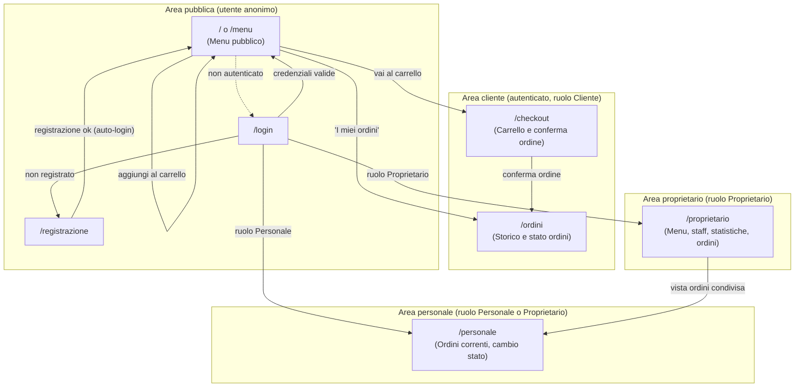
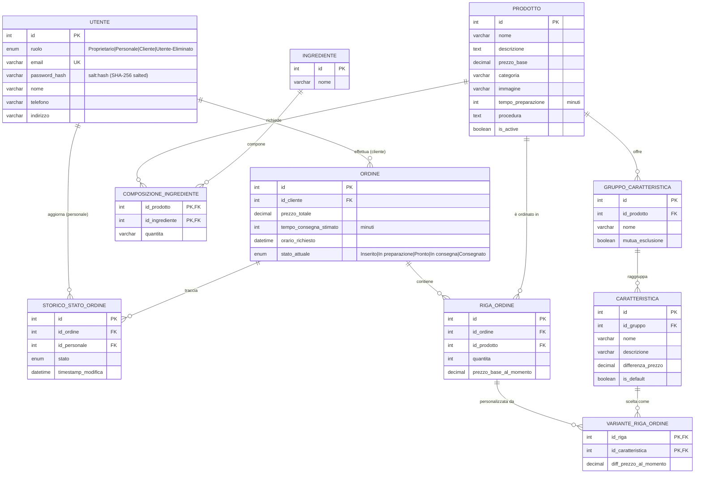

# WebDelivery — Documentazione di Progetto

Corso di Web Engineering — A.A. 2025/2026 — Specifica 1

**Autori:** Alessia De Dominicis, Pier Marco Graziani

> ⚠️ Bozza generata come base di partenza: le sezioni marcate con **[DA COMPLETARE]** richiedono un intervento manuale (test sui browser, screenshot, ripartizione dei contributi) che non può essere fatto in autonomia dall'assistente.

---

## Indice

1. [Dipendenze software](#1-dipendenze-software)
2. [Funzionalità realizzate e non realizzate](#2-funzionalità-realizzate-e-non-realizzate)
3. [Diagramma di navigazione](#3-diagramma-di-navigazione)
4. [Schema relazionale della base di dati](#4-schema-relazionale-della-base-di-dati)
5. [Descrizione del layout](#5-descrizione-del-layout)
6. [Tecnologie avanzate utilizzate](#6-tecnologie-avanzate-utilizzate)
7. [Compatibilità browser](#7-compatibilità-browser)
8. [Screenshot](#8-screenshot-opzionale)
9. [Contributo dei componenti del gruppo](#9-contributo-dei-componenti-del-gruppo)

---

## 1. Dipendenze software

### Lato server

Gestite tramite Maven (`pom.xml`), pacchettizzazione `war`, target Java 21.

| Libreria | Versione | Scopo |
|---|---|---|
| `jakarta.servlet-api` | 6.0.0 | API Servlet (scope `provided`, fornita dal container) |
| `com.mysql:mysql-connector-j` | 8.3.0 | Driver JDBC per la connessione al DBMS MySQL |
| `org.freemarker:freemarker` | 2.3.32 | Template engine lato server per la generazione delle pagine HTML |
| `no.api.freemarker:freemarker-java8` | 2.0.0 | Estensione di Freemarker per il supporto nativo alle classi `java.time` (es. `LocalDateTime`) nei template |
| `com.google.code.gson:gson` | 2.11.0 | Serializzazione/deserializzazione JSON (payload del carrello in checkout, endpoint dati REST-like come `/api/prodotti` e `/api/ordini`) |

**DBMS:** MySQL (o compatibile, es. MariaDB). Configurazione di connessione (URL, utente, password) definita come `context-param` in `WEB-INF/web.xml` e letta da `DbConnectionManager`.

### Lato client

Nessuna libreria esterna: tutto il codice JavaScript (`src/main/webapp/js/*.js`) è scritto in JavaScript "vanilla" (ES6+), senza framework né librerie di terze parti. Questa scelta è stata fatta per mantenere il progetto semplice e per rispettare lo spirito della specifica, che sconsiglia l'abuso di tecnologie client quando non necessarie.

---

## 2. Funzionalità realizzate e non realizzate

### Realizzate

**Area pubblica / anonima**
- Consultazione del menu, organizzato per categoria di prodotto (`/menu`, servlet `MenuServlet` + `MenuDataServlet` per i dati via `/api/prodotti`).
- Pagina di presentazione dell'attività (sezione "chi siamo" / "dove siamo" nella home).
- Registrazione libera come cliente, con raccolta obbligatoria di telefono e indirizzo (`/registrazione`).
- Login / logout (`/login`, `/logout`).

**Area cliente**
- Composizione dell'ordine: selezione prodotti con relative caratteristiche (comprese quelle raggruppate a mutua esclusione, con eventuale opzione di default pre-selezionata), aggiunta al carrello.
- Calcolo in tempo reale, durante la composizione del carrello, del prezzo totale e del tempo stimato di consegna (tempo di preparazione dei prodotti + tempo di percorrenza stimato).
- Checkout con scelta dell'orario di consegna, vincolato alle fasce di apertura e a non essere antecedente al tempo minimo di preparazione/consegna. Il vincolo è verificato **sia lato client** (per l'usabilità: mostra solo gli slot disponibili) **sia lato server** (per la sicurezza: un client modificato non può forzare un orario non valido).
- Ricalcolo lato server di prezzo totale e tempo di preparazione al momento della conferma dell'ordine (il client non viene mai considerato una fonte affidabile per questi valori).
- Invio email di riepilogo al momento della conferma dell'ordine e notifica quando lo stato dell'ordine passa a "In consegna" (implementato in maniera asincrona tramite `Jakarta Mail`).
- Storico ordini del cliente, con distinzione tra ordini "in corso" e "storico", e visualizzazione dello stato di avanzamento di ciascun ordine.

**Area personale**
- Vista degli ordini correnti (`/personale`).
- Cambio di stato di un ordine (`Inserito → In preparazione → Pronto → In consegna → Consegnato`), con vincolo di progressione sequenziale imposto **lato server** (non è possibile saltare stati né tornare indietro), gestito in transazione con lock pessimistico (`SELECT ... FOR UPDATE`) per evitare race condition in caso di aggiornamenti concorrenti.
- Tracciamento in `Storico_Stato_Ordine` di quale membro del personale ha effettuato ciascun cambio di stato, con data/ora.
- Visione della scheda completa di ogni prodotto in un ordine, comprese le informazioni non visibili al cliente (tempo di preparazione, ingredienti, procedura).

**Area proprietario**
- Gestione completa del menu: creazione, modifica, disattivazione dei prodotti.
- Gestione del personale: registrazione di nuovi membri, rimozione (implementata come "declassamento" del ruolo a `Utente-Eliminato` piuttosto che cancellazione fisica, per preservare l'integrità storica degli ordini già gestiti da quel membro).
- Vista di tutti gli ordini, suddivisa per stato, con data/ora di consegna richiesta, stato corrente, tempo di preparazione stimato, numero di prodotti e cronologia di chi ha effettuato ciascun cambio di stato.
- Statistiche aggregate: incasso giornaliero e mensile (selezionabile per data) e classifica dei prodotti più ordinati.

**Sicurezza (aggiunte rispetto al minimo richiesto)**
- Le password non sono mai salvate né confrontate in chiaro: hashing con SHA-256 salted (salt casuale a 16 byte per utente) e 10.000 iterazioni (key stretching), implementato senza dipendenze esterne.
- Tutte le query verso il database usano `PreparedStatement` (nessuna concatenazione di stringhe SQL, quindi nessuna superficie di SQL injection).
- Controllo dei ruoli centralizzato (`BaseServlet.verificaRuoli`) su ogni endpoint riservato.

### Non realizzate / parzialmente realizzate

- **Verifica dell'indirizzo email in fase di registrazione** (link di conferma) — *opzionale nella specifica*. Non implementata.
- **Paginazione del menu** — *opzionale nella specifica* ("magari paginato"). Il menu è attualmente organizzato per categoria ma non paginato; con il catalogo attuale (poche decine di prodotti) non è un problema di usabilità, ma andrebbe aggiunta se il catalogo crescesse.
- **Stima del tempo di consegna basata sulla distanza reale** dall'indirizzo del cliente — *opzionale nella specifica*. Attualmente si usa un tempo di percorrenza fisso (10 minuti); il codice client (`checkout.js`) è già isolato in una costante dedicata proprio in previsione di questa estensione futura.
- **Validazione HTML5 formale** delle pagine principali (W3C Validator) — da eseguire e riportare qui con l'esito. [DA COMPLETARE]

---

## 3. Diagramma di navigazione

**Note sul diagramma:**
- L'accesso a `/checkout`, `/ordini`, `/personale` e `/proprietario` richiede sessione valida (`BaseServlet.richiediAutenticazione`); in assenza di sessione l'utente viene reindirizzato a `/login`.
- L'accesso a `/personale` è consentito ai ruoli `Personale` e `Proprietario`; l'accesso a `/proprietario` è riservato al solo ruolo `Proprietario` (`BaseServlet.verificaRuoli`).
- Endpoint dati JSON di supporto (non pagine navigabili): `GET /api/prodotti` (usato da `menu.js`) e `GET /api/ordini` (usato da `orders.js`).

---

## 4. Schema relazionale della base di dati

**Scelte progettuali rilevanti:**
- I prezzi (`prezzo_base_al_momento` in `Riga_Ordine`, `diff_prezzo_al_momento` in `Variante_Riga_Ordine`) vengono **congelati al momento dell'ordine**: se in seguito il proprietario cambia il prezzo di un prodotto o di una caratteristica, gli ordini già effettuati non vengono alterati retroattivamente.
- I membri del personale non vengono mai cancellati fisicamente (`DELETE`), ma "declassati" a `Utente-Eliminato`, per non perdere la tracciabilità in `Storico_Stato_Ordine` (vincolo di integrità referenziale sugli ordini già gestiti).
- La mutua esclusione tra caratteristiche è modellata a livello di `Gruppo_Caratteristica.mutua_esclusione`, applicata poi lato applicativo (non con un vincolo SQL diretto, che sarebbe complesso da esprimere in modo portabile).

Script SQL completi: `sql/01_create_tables.sql` (schema) e `sql/02_insert_data.sql` (dati di esempio).

---

## 5. Descrizione del layout

Il sito è organizzato attorno a un template Freemarker (`WEB-INF/templates/`), con fogli di stile CSS dedicati per area funzionale:

| File CSS | Ambito |
|---|---|
| `style.css` | Stili di base condivisi (header, footer, tipografia, componenti comuni a tutte le pagine) |
| `auth.css` | Pagine di login e registrazione |
| `checkout.css` | Pagina di checkout/carrello |
| `orders.css` | Storico ordini cliente |
| `staff.css` | Vista personale |
| `proprietario.css` | Vista proprietario (menu, statistiche, staff) |

**Componenti statici** (markup generato server-side, invariato dopo il caricamento della pagina): intestazione (`site-header`), footer (`site-footer`), struttura di base delle pagine (liste prodotti/ordini come scheletro HTML popolato via Freemarker o via fetch, a seconda della pagina — vedi sezione 6).

**Componenti dinamici** (gestiti via JavaScript dopo il caricamento):
- Carrello: interamente gestito lato client con `localStorage` (chiave `wd_cart`), per permettere all'utente di comporre l'ordine navigando tra le pagine del menu senza perderlo.
- Filtri (es. tab "In corso / Storico" nello storico ordini, filtri di stato nella vista personale).
- Apertura/chiusura dei dettagli di un ordine (accordion).
- Validazione client-side dei form (email, orario di consegna, ecc.), sempre accompagnata da una validazione equivalente lato server.

**[DA COMPLETARE]**: aggiungere qui uno screenshot o una breve descrizione visiva delle pagine principali (menu, checkout, area personale, area proprietario) una volta stabilizzato il layout definitivo.

---

## 6. Tecnologie avanzate utilizzate

- **Freemarker** come template engine lato server, per separare la generazione dell'HTML dalla logica applicativa nelle servlet.
- **Pattern "dati via fetch" per alcune viste** (es. storico ordini cliente, catalogo prodotti): invece di iniettare i dati direttamente nel template Freemarker, alcune pagine (`index.ftl`/`menu.js`, `storico-ordini.ftl`/`orders.js`) caricano i dati in JSON da endpoint dedicati (`/api/prodotti`, `/api/ordini`) tramite `fetch()`. Questo mantiene i template Freemarker privi di logica applicativa (solo markup + un singolo `<script src="...">`) e rende i file JavaScript riutilizzabili e testabili in isolamento. *(Nota: al momento questo pattern è applicato solo ad alcune viste; le altre — vista personale e vista proprietario — usano ancora dati iniettati direttamente nel template, in attesa di un refactor analogo.)*
- **Gson** per la serializzazione/deserializzazione JSON, sia lato client→server (parsing del carrello inviato in checkout) sia lato server→client (endpoint `/api/prodotti` e `/api/ordini`).
- **Hashing delle password "from scratch"**: per evitare di introdurre una dipendenza esterna dedicata (es. BCrypt) è stato implementato un semplice schema salt + SHA-256 con key stretching (10.000 iterazioni) in `PasswordUtil`, sufficiente per gli scopi didattici del progetto pur non essendo allo stato dell'arte quanto Argon2/BCrypt.
- **Transazioni e locking pessimistico a livello DB**: l'aggiornamento dello stato di un ordine (`OrdineDAO.updateStato`) usa una transazione esplicita con `SELECT ... FOR UPDATE` per leggere lo stato corrente, verificarne la progressione valida e aggiornarlo in modo atomico, evitando race condition se due membri del personale tentano di modificare lo stesso ordine contemporaneamente.
- **Ricalcolo server-side di prezzo, tempo di preparazione e validità dell'orario di consegna** in fase di checkout: il client invia solo l'intenzione d'ordine (prodotti, quantità, caratteristiche scelte, orario desiderato); tutti i valori economicamente/funzionalmente rilevanti vengono ricalcolati e validati leggendo lo stato reale del catalogo dal database, per non fidarsi ciecamente dei dati inviati dal browser.

---

## 7. Compatibilità browser

**[DA COMPLETARE]** — La specifica richiede di dichiarare esplicitamente il buon funzionamento su Edge, Firefox e Chrome nelle versioni più recenti, e di segnalare eventuali problemi su browser meno recenti. Suggerimento per completare questa sezione:

1. Testare le pagine principali (menu, login/registrazione, checkout, storico ordini, vista personale, vista proprietario) sulle ultime versioni di Chrome, Firefox ed Edge.
2. Annotare qui eventuali problemi di rendering o funzionalità riscontrati.
3. Se possibile, testare anche su un browser meno recente o su Opera, e descrivere come le funzionalità "degradano" (es. con JavaScript disabilitato, le funzionalità di base — consultazione menu, login — dovrebbero restare accessibili, mentre la composizione dinamica del carrello no).

| Browser | Versione testata | Esito |
|---|---|---|
| Chrome | — | [DA COMPLETARE] |
| Firefox | — | [DA COMPLETARE] |
| Edge | — | [DA COMPLETARE] |
| Opera *(opzionale)* | — | [DA COMPLETARE] |

---

## 8. Screenshot *(opzionale)*

**[DA COMPLETARE]** — Inserire qui screenshot delle pagine più rappresentative: menu pubblico, composizione carrello, checkout, storico ordini cliente, vista personale (cambio stato ordine), vista proprietario (gestione menu e statistiche).

---

## 9. Contributo dei componenti del gruppo

**[DA COMPLETARE]** — La specifica richiede di indicare chi si è dedicato prevalentemente a quale parte (server, layout, client, ecc.). Esempio di struttura da compilare:

| Componente | Aree di contributo principali |
|---|---|
| Alessia De Dominicis | *(da compilare: es. backend/servlet, DAO, schema DB, ...)* |
| Pier Marco Graziani | *(da compilare: es. layout/CSS, JavaScript client, ...)* |

*(In un progetto a due, è comune che entrambi abbiano contribuito trasversalmente a più parti: se così è stato, indicarlo esplicitamente insieme a chi si è occupato "prevalentemente" di cosa, come richiesto dalla specifica.)*
